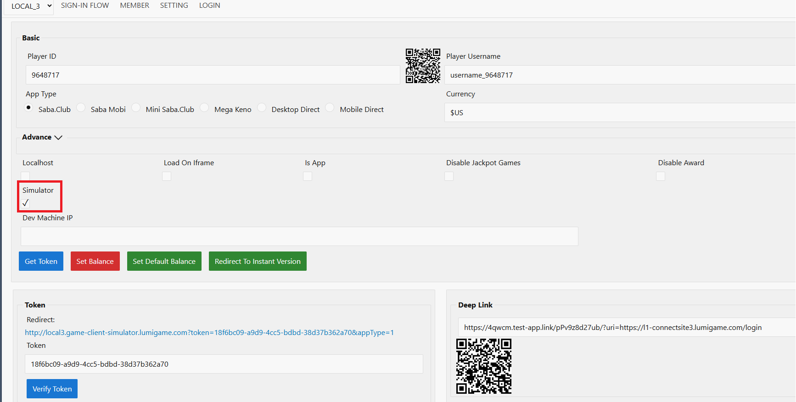
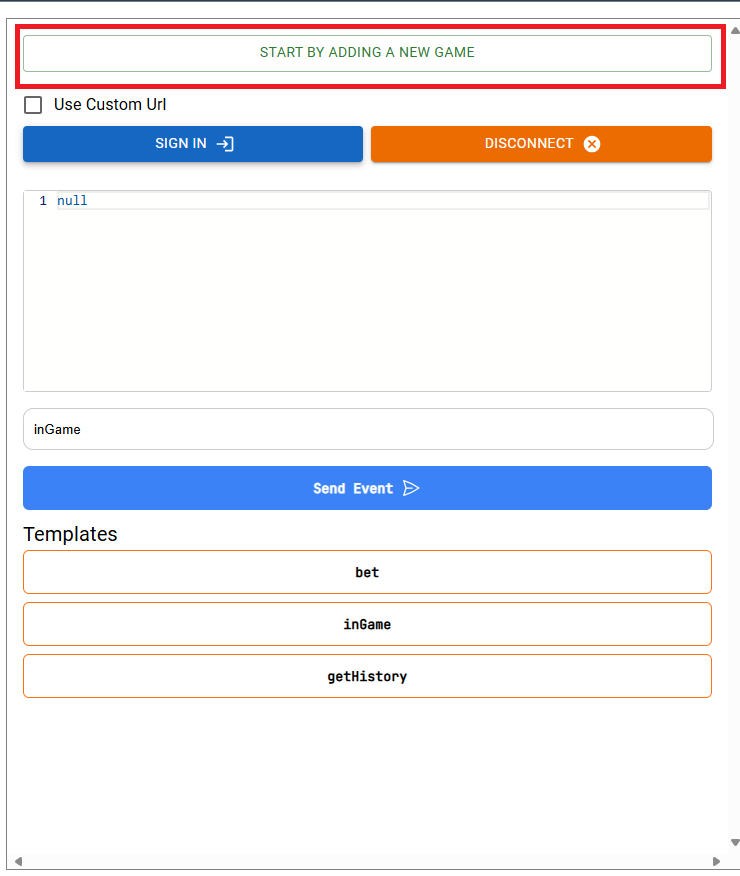
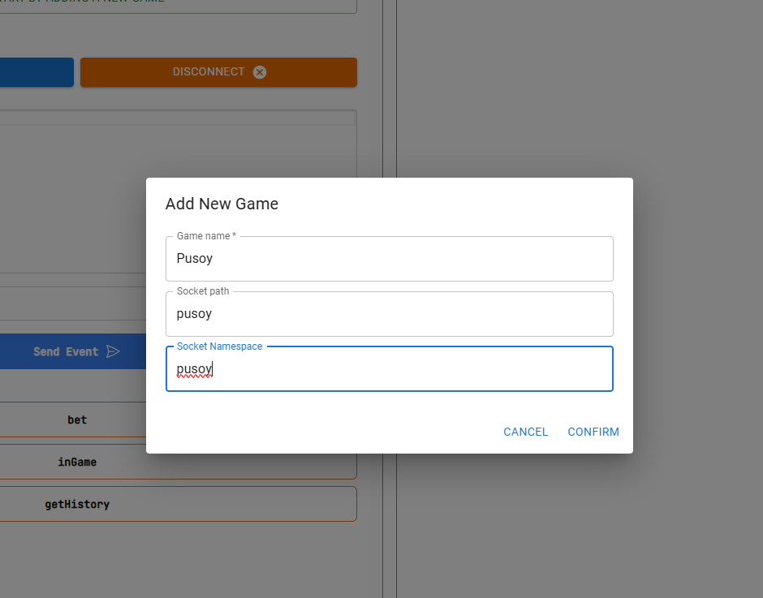
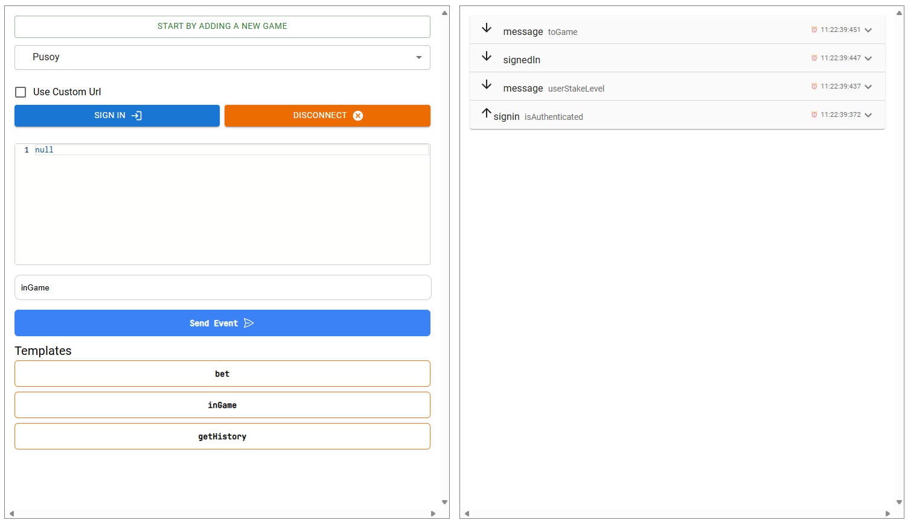
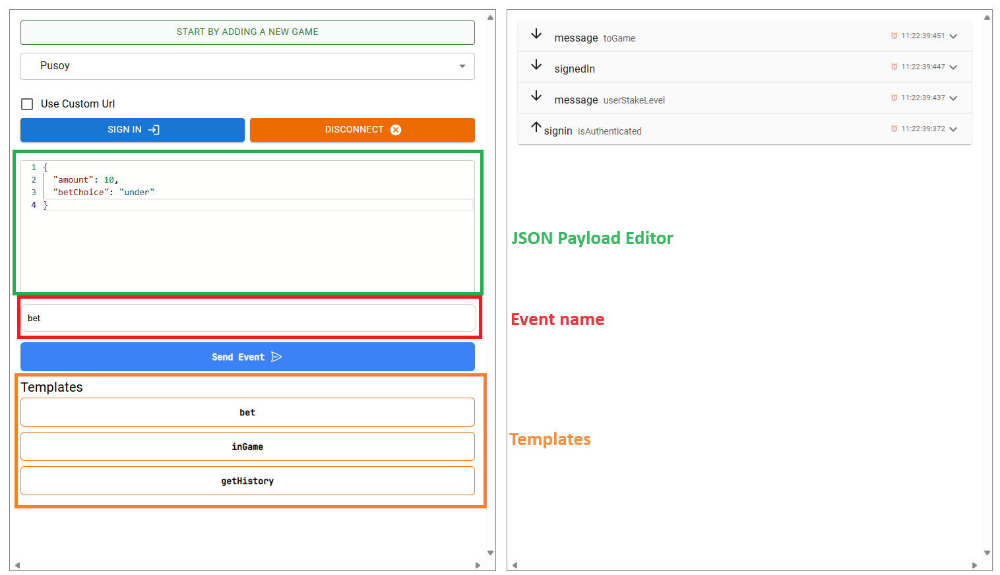
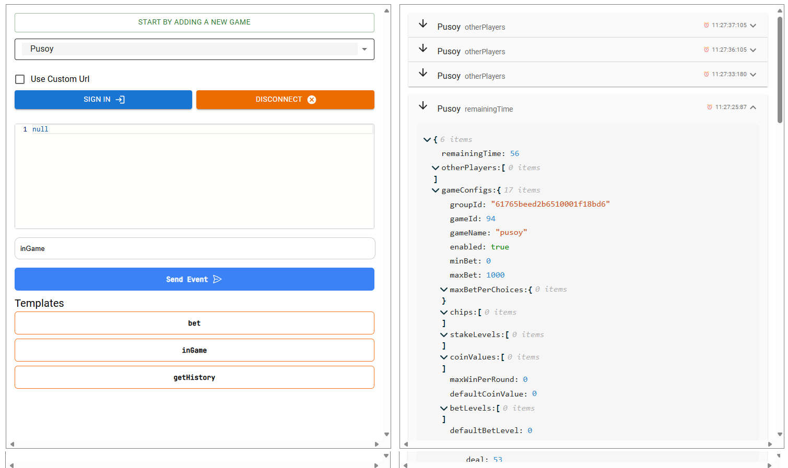

# Game Client Simulator

## Overview

The game client simulator serves the following:
- For game service developers to debug socket event locally.
- For testers to test game service when cocos game client is not ready.
- For game client developers for game event references.

## Usage

### Open the simulator

- Go to game lobby simulator.
Example [ LOCAL_3 Simulator](https://l1-glbs3.lumigame.com/signin?obCustId=9648717&appType=1)
- Make sure to enter the lobby information correspondingly.
- Click on Simulator checkbox

- Click Get Token.
- Click on the link below Redirect to open simulator .

### Add a game

- Click on "Start by adding a new game":

- Enter game name, path and namespace. The game name is up to you. The socket path and namespace depend on the service configuration:

Please be informed that the game info are stored in local storage of your web browser.
### Connect to game
- Click Sign In to connect and log in to the game service

### Send an event
- Click on an event template to create an event to send to the game service.

- OR edit event name and JSON data on the editor to send custom event.
- Click on Send Event to send event to the game service.
- Watch sent and received event on the right section.
- For more information about sent and received event, click on the event to expand its detail

### Dev machine development
- Click on Use Custom Url and change the url to localhost:port for debug locally on dev machine

## Supported environment
- LOCAL_3

For other environment, please paste the Game Client Simulator url into the Dev Machine IP
- LOCAL: game-client-simulator.lumigame.com
- LOCAL_1: local1.game-client-simulator.lumigame.com/
- LOCAL_2: local2.game-client-simulator.lumigame.com/